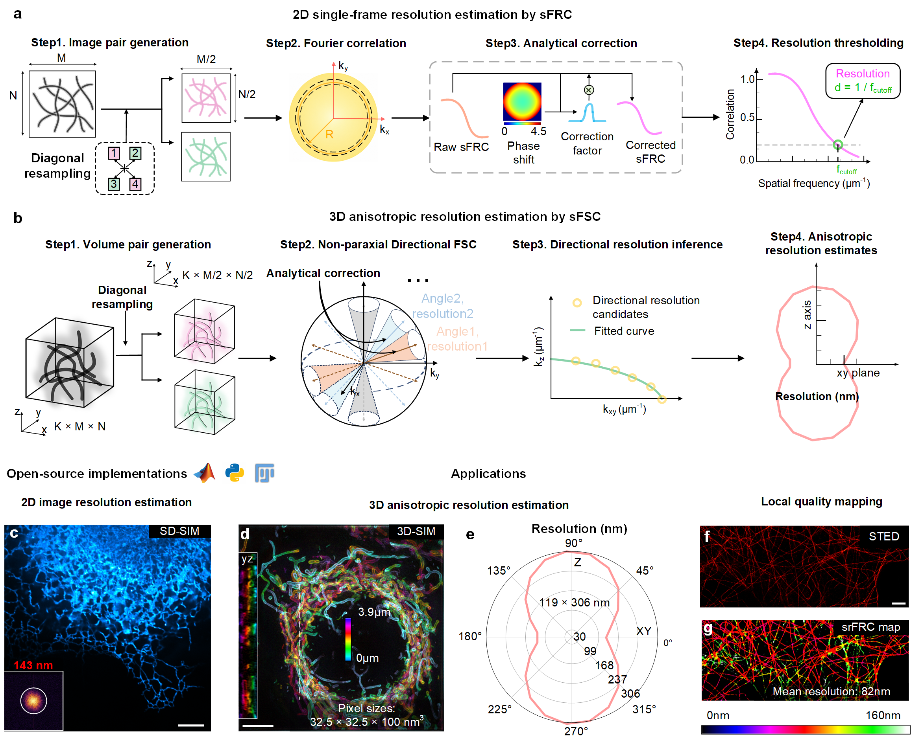

# srFRCpy

Python implementation of the single-acquisition sFRC/sFSC resolution-estimation framework.

**Note: this repository is still in heavy development.** If you encounter any issues or unexpected behavior, please [file an issue](https://github.com/SR-Wiki/srFRCpy/issues).

## Publication

This repository accompanies the manuscript:

> **Single-acquisition estimation of anisotropic 3D resolution in super-resolution fluorescence microscopy**

Final bibliographic information and DOI will be added after publication.

**Other implementations:** [Fiji/ImageJ / srFRCj](https://github.com/SR-Wiki/srFRCj) · [MATLAB / srFRCm](https://github.com/SR-Wiki/srFRCm)

[Introduction](#introduction) · [Installation](#installation) · [Demo scripts](#demo-scripts) · [Basic parameters](#basic-parameters) · [Version](#version) · [Resources](#resources) · [License](#license)

## Introduction

Effective resolution in fluorescence microscopy depends on the sample, fluorophores, acquisition conditions and reconstruction procedure, creating a need for direct resolution assessment from acquired data. Fourier ring correlation (FRC) and Fourier shell correlation (FSC) provide image-based resolution estimates from the highest spatial frequencies shared by two observations, but repeated fluorescence acquisitions can be compromised by sample dynamics, photobleaching, drift and acquisition variability.

Three-dimensional fluorescence imaging presents an additional challenge because optical resolution is anisotropic, voxel spacings and array dimensions commonly differ across axes, and sequential z-stack acquisition can introduce inter-slice inconsistencies. These effects make direct axial-resolution estimation particularly sensitive to paraxial Fourier artifacts and acquisition-dependent changes.

The framework addresses these problems with **single-frame FRC (sFRC)** and **single-volume FSC (sFSC)**. sFRC generates two complementary observations from one 2D image by exploiting local spatial redundancy and point-spread-function symmetry, followed by an analytical frequency-domain correction for the deterministic bias introduced by diagonal resampling. sFSC extends the same single-acquisition principle to 3D volumes and introduces **directional resolution inference (DRI)**, which estimates axial resolution from reliable non-paraxial directional FSC information while accommodating anisotropic resolution and unequal sampling. The framework is further extended to spatially resolved analysis through **srFRC**.

<p align="center">

</p>

## Installation

### Tested platform
  - Windows 10, Python = 3.10.0

### Dependencies
| Package | Supported range | 
| --- | --- | 
| NumPy | `>=2.0,<2.3` | 
| SciPy | `>=1.14,<1.16` | 
| scikit-image | `>=0.24,<0.26` | 
| Matplotlib | `>=3.9,<3.11` | 
| Pillow | `>=10.4,<12` | 
| tifffile | `>=2024.9.20,<2025` | 
| imageio | `>=2.33,!=2.35.0,<3` | 
| tqdm | `>=4.66,<5` | 

### 1. Clone or download the repository

```bash
git clone https://github.com/SR-Wiki/srFRCpy.git
cd srFRCpy
```

### 2. Create the `srFRC` Python environment

A dedicated environment named **`srFRC`** is recommended. Using Conda is the simplest option for keeping the scientific Python dependencies isolated.

```bash
conda create -n srFRC python=3.10
conda activate srFRC
```


### 3. Install dependencies

After activating the `srFRC` environment, install the required packages from the provided `requirements.txt` file:

```bash
python -m pip install --upgrade pip
pip install -r requirements.txt
```

The three core implementations are colocated in `src/`. The `demos/` folder
contains exactly three runnable examples: `sFRC_demo.ipynb`, `sFSC_demo.ipynb` and
`srFRC_demo.ipynb`. 

## Demo scripts

Download and extract the **example_data.zip** asset from
[srFRCj Releases](https://github.com/SR-Wiki/srFRCj/releases/download/v1.0/example_data.zip) into the project-root
`example_data/`, alongside `src/` and `demos/`. Edit the explicit path and calibrated pixel size in each
demo if your files differ. 


```bash
python demos/sFRC_demo.ipynb
python demos/sFSC_demo.ipynb
python demos/srFRC_demo.ipynb
```

Python sampling is in nm; stacks use TYX and sFSC volumes ZYX with spacing
`[z,y,x]`. The examples are provided as Python scripts in `demos/`.

See [demo outputs](docs/advancedParameters.md#demo-outputs) for saved formats
and [advanced parameters](docs/advancedParameters.md) for the current policy.


## Basic parameters

The analysis modes are listed below. Language-specific parameter names,
defaults, batching and result interpretation are documented in
[docs/advancedParameters.md](docs/advancedParameters.md). The main function
docstrings in `src/` describe the inputs and returned data.

### sFRC

| Parameter | Default / source | Description |
| --- | --- | --- |
| Pixel Size | image calibration or user input | Physical lateral sampling in nm |
| If SingleFrame | `true` | Generates the complementary pair from one acquisition |

### sFSC

| Parameter | Default / source | Description |
| --- | --- | --- |
| Pixel Size (XY) | image calibration or user input | Physical lateral voxel spacing in nm |
| Pixel Size (Z) | image calibration or user input | Physical axial voxel spacing in nm |
| If SingleFrame | `true` | Enables single-volume pair generation |

### srFRC

| Parameter | Default / source | Description |
| --- | --- | --- |
| Block Size | `64` pixels | Local rolling-analysis window |
| Skip | `2` pixels | Step between neighboring rolling windows |
| Pixel Size | image calibration or user input | Physical lateral sampling in nm |
| If SingleFrame | `true` | Uses single-frame pair generation for local analysis |

Advanced controls for **sFRC**, **sFSC/DRI**, and **srFRC** are documented separately in [docs/advancedParameters.md](docs/advancedParameters.md).

> **Reference implementation:** For computational efficiency and numerical accuracy, the [MATLAB implementation (srFRCm)](https://github.com/SR-Wiki/srFRCm) is the reference. When comparing implementations or investigating discrepancies, use MATLAB results and execution times as the baseline. Python and Java may differ in numerical output and runtime performance.

## Version

**v0.1.11**

## Resources

- [Advanced parameters](docs/advancedParameters.md)
- [Fiji/ImageJ implementation — srFRCj](https://github.com/SR-Wiki/srFRCj)
- [Python implementation — srFRCpy](https://github.com/SR-Wiki/srFRCpy)
- [srFRCJ Wiki](https://github.com/SR-Wiki/srFRCj/wiki/)
- [Related rolling-FRC publication](https://doi.org/10.1038/s41377-023-01321-0)

## License

## Open source [srFRC](https://github.com/SR-Wiki/srFRCpy)
This software and corresponding methods can only be used for **non-commercial** use, and they are under Open Data Commons Open Database License v1.0.

